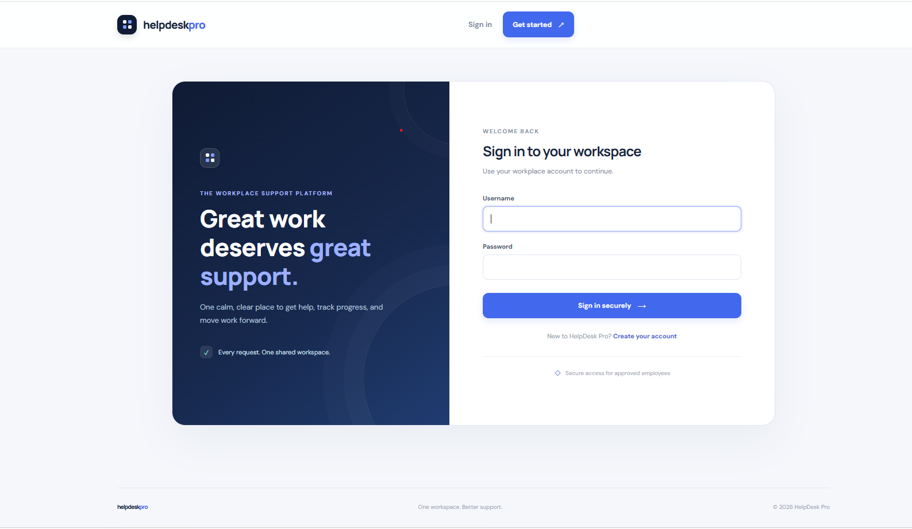
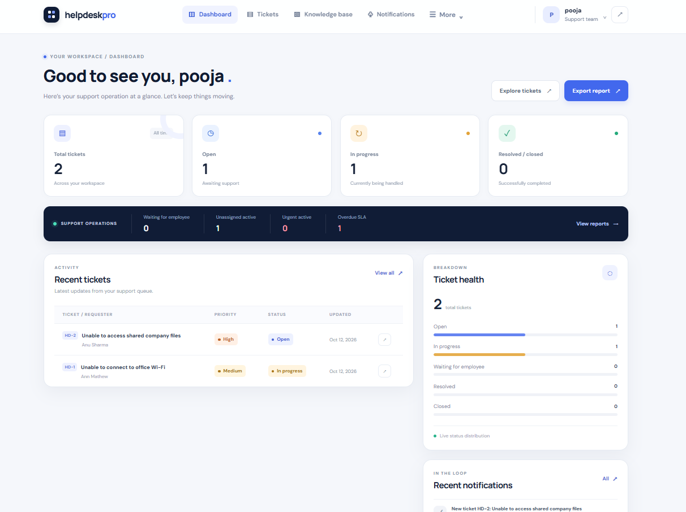
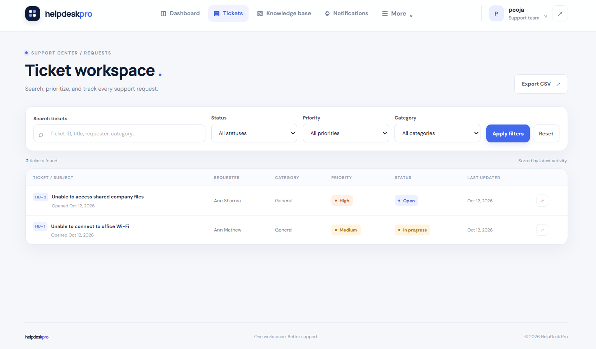
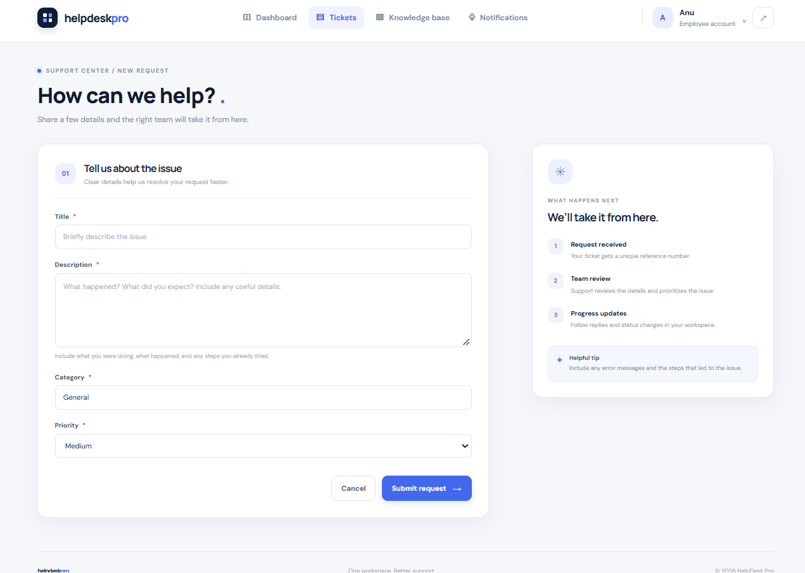
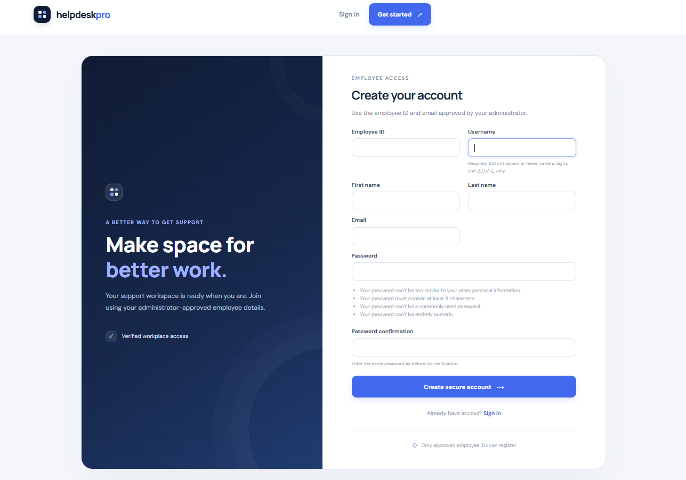
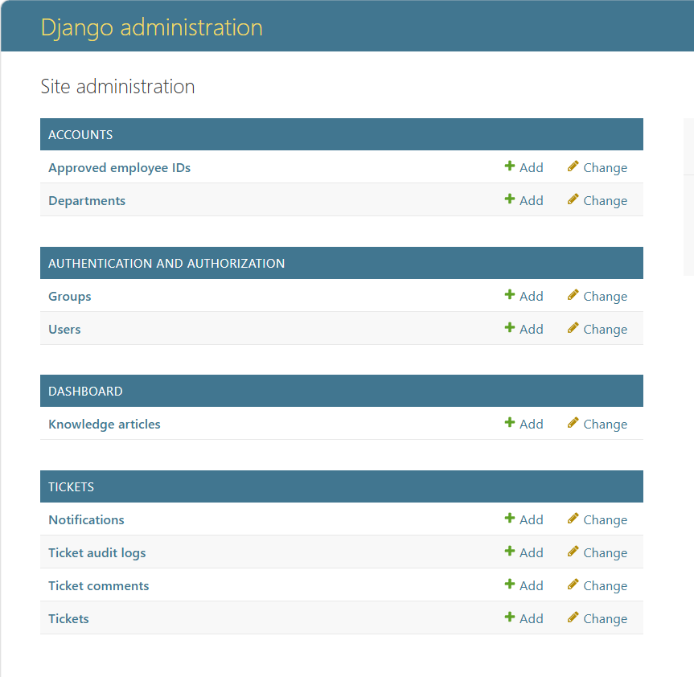
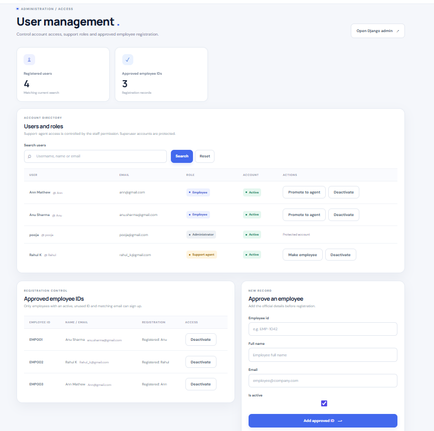

# HelpDesk Pro

HelpDesk Pro is a web application built with Python and Django for managing employee support requests. Employees can raise tickets, support agents can handle assigned tickets, and administrators can manage users and the support process.

## Screenshots

### Login Page



### Dashboard



### Ticket Management



### Create Ticket



### Employee Registration



### Administration



### User Management



## Features

- User authentication and account management
- Role-based access for employees, support agents, and administrators
- Support ticket creation and tracking
- Ticket assignment, priority, and status management
- Ticket search and filtering
- Dashboard with ticket information
- User and department management
- Ticket comments and activity history
- Notifications and SLA deadline tracking
- Reporting and CSV export

## Technologies Used

- Python
- Django
- Django REST Framework
- PostgreSQL and SQLite
- HTML, CSS, and JavaScript
- Git and GitHub

## Project Structure

```text
HelpDesk-Pro/
├── accounts/
├── config/
├── dashboard/
├── docs/
├── static/
├── templates/
├── tickets/
├── .env.example
├── .gitignore
├── manage.py
├── README.md
└── requirements.txt
```

## Installation and Setup

### Prerequisites

- Python
- Git
- PostgreSQL, if you want to use PostgreSQL instead of SQLite

### 1. Get the Project

If you already have the project on your computer, open its folder in VS Code and continue to the next step.

Otherwise, clone your GitHub repository:

```bash
git clone <your-github-repository-url>
cd HelpDesk-Pro
```

### 2. Create a Virtual Environment

```powershell
python -m venv venv
```

### 3. Activate the Virtual Environment

On Windows PowerShell:

```powershell
.\venv\Scripts\Activate.ps1
```

### 4. Install Dependencies

```powershell
pip install -r requirements.txt
```

### 5. Configure Environment Variables

SQLite is used by default, so PostgreSQL configuration is not required for a basic local setup.

To use PostgreSQL, create a `.env` file in the project root with your database details:

```env
DJANGO_SECRET_KEY=replace-with-a-secret-key
DJANGO_DEBUG=True
DJANGO_ALLOWED_HOSTS=127.0.0.1,localhost

DB_ENGINE=postgres
DB_NAME=helpdesk_pro_db
DB_USER=postgres
DB_PASSWORD=your_postgresql_password
DB_HOST=localhost
DB_PORT=5432
```

Create the PostgreSQL database before running migrations. Make sure the database username and password match your PostgreSQL configuration.

Keep your actual `.env` file private. Never upload real passwords or secret keys to GitHub.

### 6. Apply Database Migrations

```powershell
python manage.py migrate
```

### 7. Create an Administrator Account

```powershell
python manage.py createsuperuser
```

Follow the instructions in the terminal.

### 8. Start the Development Server

```powershell
python manage.py runserver
```

Open http://127.0.0.1:8000/ in your browser.

## Application Workflow

1. Employees submit support tickets describing their issues.
2. Support agents work on assigned tickets and update their progress.
3. Administrators manage users, roles, and departments.
4. Users track ticket progress using the features available to their roles.

Available actions depend on the permissions configured in the application.

## Running Tests

Run the automated tests with:

```powershell
python manage.py test
```

The test suite helps verify the application workflows covered by the project's tests.

## Security

- Keep secret keys and database passwords out of source control.
- Use environment variables for sensitive settings.
- Disable Django debug mode before production deployment.
- Configure allowed hosts appropriately for the deployment environment.
- Review role permissions before making the application publicly accessible.
